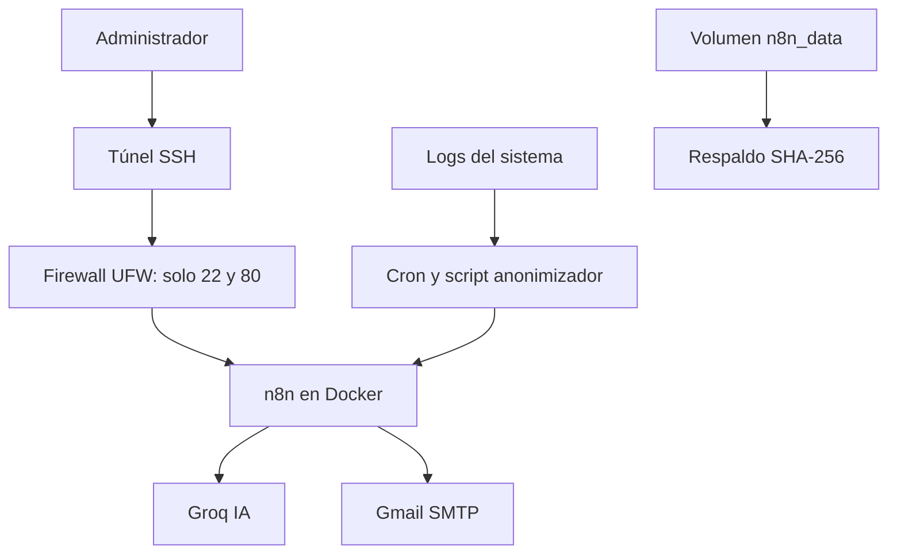

# Arquitectura

## Decisiones
- n8n se publica solo en 127.0.0.1:5678 y se accede por túnel SSH.
- El log se anonimiza antes de salir del servidor.
- La respuesta de la IA se contrasta con un conteo real.
